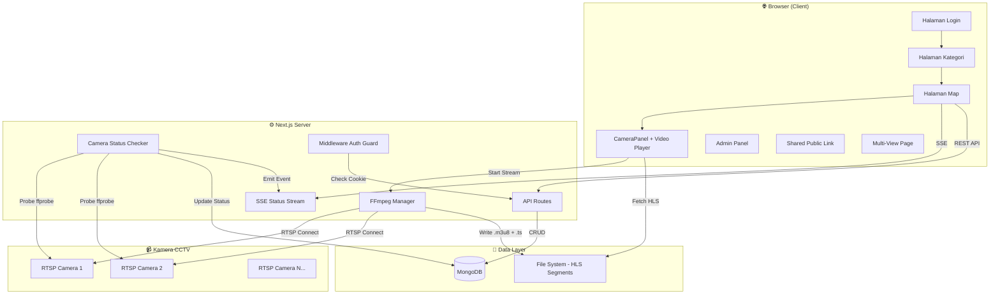
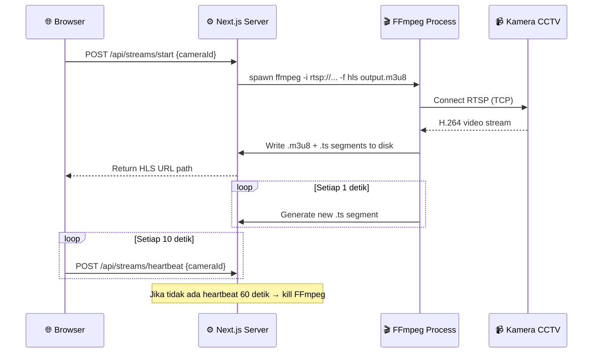
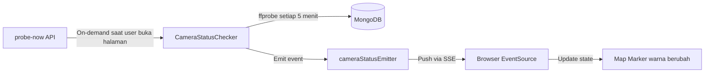
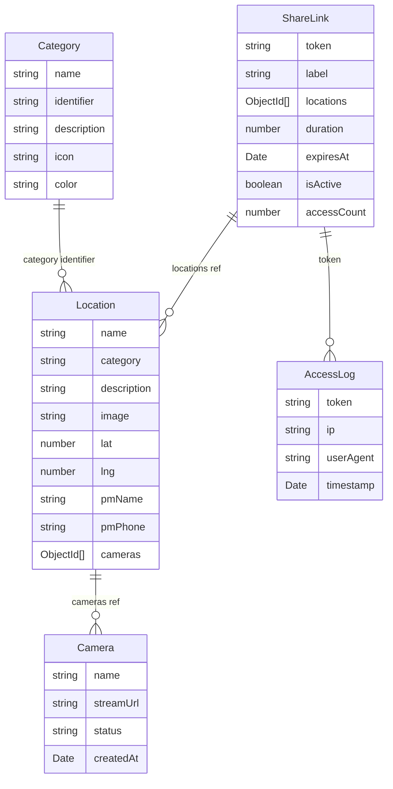

# 🔭 TENGOK — Surveillance Integration System
### Dokumentasi Arsitektur & Cara Kerja Aplikasi

---

## 1. Apa Itu TENGOK?

**TENGOK** adalah sistem monitoring CCTV berbasis web yang dibangun untuk **PT Brantas Abipraya** (BUMN Konstruksi). Aplikasi ini memungkinkan pemantauan kamera CCTV secara real-time dari berbagai lokasi proyek konstruksi di seluruh Indonesia melalui **peta interaktif**.

---

## 2. Tech Stack

| Kategori | Teknologi | Versi | Fungsi |
|----------|-----------|-------|--------|
| **Framework** | Next.js (App Router) | 16.1.6 | Full-stack React framework (SSR + API Routes) |
| **Runtime** | React | 19.2.3 | UI rendering |
| **Database** | MongoDB + Mongoose | 8.23.0 | NoSQL database untuk semua data |
| **Styling** | Tailwind CSS | v4 | Utility-first CSS |
| **Animasi** | Framer Motion | 12.35.2 | Micro-animations & page transitions |
| **Peta** | Leaflet + react-leaflet | 5.0.0 | Peta interaktif OpenStreetMap |
| **Video** | FFmpeg + hls.js | 1.6.15 | Konversi RTSP→HLS & playback di browser |
| **Chart** | Recharts | 3.8.1 | Grafik statistik |
| **Icons** | Lucide React | 0.574.0 | Icon set |
| **Forms** | React Hook Form + Zod | 7.71 / 4.3 | Form validation |
| **Data Fetching** | SWR + Axios | 2.4 / 1.13 | Client-side data fetching & caching |
| **Auth** | Cookie-based (bcryptjs) | — | Simple token auth |

---

## 3. Arsitektur Aplikasi



---

## 4. Alur Kerja (User Flow)

### 4.1 Flow Utama (Internal User)

```
Login → Pilih Kategori → Lihat Peta → Klik Marker → Panel Kamera Terbuka → Tonton Video CCTV
```

1. **Login** (`/login`) — Autentikasi dengan username/password, disimpan di cookie `auth_token`
2. **Kategori** (`/categories`) — Pilih jenis proyek (misal: "Sekolah Rakyat")
3. **Peta** (`/map?category=sekolah-rakyat`) — Peta Indonesia dengan marker lokasi proyek
4. **Klik Marker** — Panel samping muncul, menampilkan daftar kamera di lokasi tersebut
5. **Play Video** — FFmpeg mulai konversi RTSP→HLS, video muncul di browser

### 4.2 Flow Publik (Share Link)

```
Buka Link → Validasi Token & Expiry → Lihat Peta (terbatas) → Tonton CCTV
```

- Admin membuat **Share Link** dengan durasi terbatas (30/60/120/180 menit)
- Pengguna publik mengakses `/shared/[token]`
- Sistem validasi token + expiry → tampilkan peta dengan lokasi yang diizinkan saja

### 4.3 Flow Admin

```
Login → Admin Panel → Kelola Kamera / Lokasi / Kategori / Share Links / Statistik
```

---

## 5. Komponen Utama

### 📁 Struktur Folder

```
src/
├── app/                          # Next.js App Router pages
│   ├── layout.tsx                # Root layout (font, providers)
│   ├── globals.css               # Global styles
│   ├── login/                    # Halaman login
│   ├── categories/               # Pilih kategori proyek
│   ├── map/                      # Peta utama CCTV
│   ├── multiview/                # Multi-kamera grid view
│   ├── shared/[token]/           # Public share link page
│   ├── admin/                    # Admin dashboard
│   │   ├── layout.tsx            # Sidebar + navigation
│   │   ├── page.tsx              # Manajemen kamera
│   │   ├── locations/            # Manajemen lokasi/proyek
│   │   ├── categories/           # Manajemen kategori
│   │   ├── share-links/          # Manajemen share link
│   │   └── statistics/           # Statistik pengunjung
│   └── api/                      # Backend API Routes
│       ├── auth/                 # Login/logout endpoints
│       ├── cameras/              # CRUD kamera
│       │   ├── probe-now/        # Trigger probe status on-demand
│       │   ├── status-stream/    # SSE endpoint (real-time push)
│       │   └── check-status/     # One-off status check
│       ├── categories/           # CRUD kategori
│       ├── locations/            # CRUD lokasi
│       ├── share-links/          # CRUD share links
│       ├── streams/              # Start/stop/heartbeat FFmpeg
│       │   ├── start/            # Mulai stream RTSP→HLS
│       │   ├── stop/             # Hentikan stream
│       │   ├── heartbeat/        # Keep-alive dari viewer
│       │   └── probe/            # Probe single camera
│       ├── stream-file/          # Serve HLS .m3u8 & .ts files
│       ├── stats/                # Analytics data
│       └── system/               # System health info
│
├── components/                   # React components
│   ├── MapComponent.tsx          # Peta Leaflet + marker + search
│   ├── CameraPanel.tsx           # Panel samping detail kamera
│   ├── OptimizedVideoPlayer.tsx  # HLS video player (hls.js)
│   ├── ResourceMonitor.tsx       # Monitor CPU/RAM server
│   └── Providers.tsx             # React context providers
│
├── hooks/
│   └── useCameraStatusSSE.ts     # Hook SSE real-time status
│
├── lib/                          # Server-side utilities
│   ├── db.ts                     # MongoDB connection (singleton)
│   ├── ffmpegManager.ts          # FFmpeg process manager
│   ├── cameraStatusChecker.ts    # Background probe service
│   ├── cameraStatusEmitter.ts    # EventEmitter for SSE bridge
│   └── StreamManager.ts          # Stream session management
│
├── models/                       # Mongoose schemas
│   ├── Camera.ts                 # { name, streamUrl, status }
│   ├── Location.ts               # { name, category, lat, lng, cameras[], pmName }
│   ├── Category.ts               # { name, identifier, icon, color }
│   ├── ShareLink.ts              # { token, locations[], duration, expiresAt }
│   └── AccessLog.ts              # { token, ip, userAgent, timestamp }
│
└── middleware.ts                 # Auth guard + redirects
```

---

## 6. Sistem Streaming Video (Core Feature)

Ini adalah fitur paling kritis dari TENGOK. Berikut cara kerjanya:

### Alur RTSP → Browser



### Key Design Decisions:
- **`-c:v copy`** — Tidak ada transcoding, video langsung di-copy dari RTSP ke HLS (0% CPU usage)
- **`-hls_time 1`** — Segment 1 detik untuk latency rendah
- **`-hls_list_size 3`** — Hanya simpan 3 segment terakhir (hemat disk)
- **Heartbeat system** — Client kirim heartbeat tiap 10 detik, jika idle 60s → FFmpeg dimatikan otomatis
- **Singleton pattern** — `ffmpegManager` di-persist di `global` agar survive Next.js HMR

---

## 7. Sistem Pengecekan Status (Real-time)



| Komponen | File | Fungsi |
|----------|------|--------|
| **CameraStatusChecker** | `lib/cameraStatusChecker.ts` | Background service, probe RTSP via `ffprobe` tiap 5 menit |
| **cameraStatusEmitter** | `lib/cameraStatusEmitter.ts` | Node.js EventEmitter sebagai bridge ke SSE |
| **SSE Endpoint** | `api/cameras/status-stream/route.ts` | Long-lived HTTP connection, push status ke browser |
| **useCameraStatusSSE** | `hooks/useCameraStatusSSE.ts` | React hook, terima event → update `realtimeStatuses` state |
| **probe-now** | `api/cameras/probe-now/route.ts` | Fire-and-forget trigger saat page load |

---

## 8. Database Schema (MongoDB)



---

## 9. Keamanan & Auth

| Mekanisme | Detail |
|-----------|--------|
| **Login** | Username/password → `bcryptjs` hash comparison → set cookie `auth_token` |
| **Middleware** | `middleware.ts` intercept semua route, redirect ke `/login` jika tidak ada cookie |
| **Public Routes** | `/categories`, `/map`, `/multiview`, `/shared/*`, `/api/*` → bebas akses |
| **Protected Routes** | `/admin/*` → wajib login |
| **Share Links** | Token-based, auto-expire setelah durasi habis |

---

## 10. Halaman-Halaman Aplikasi

| Route | Akses | Deskripsi |
|-------|-------|-----------|
| `/login` | Public | Halaman login admin |
| `/categories` | Public | Pilih kategori proyek (grid cards) |
| `/map?category=x` | Public | Peta interaktif dengan marker CCTV |
| `/multiview` | Public | Grid view multi-kamera sekaligus |
| `/shared/[token]` | Public | Akses CCTV via link berbatas waktu |
| `/admin` | Auth | Manajemen perangkat kamera (CRUD) |
| `/admin/locations` | Auth | Manajemen lokasi proyek + peta picker |
| `/admin/categories` | Auth | Manajemen kategori + icon/warna |
| `/admin/share-links` | Auth | Buat & kelola share link publik |
| `/admin/statistics` | Auth | Dashboard statistik pengunjung |

---

## 11. Dependency Eksternal

| Software | Wajib? | Fungsi |
|----------|--------|--------|
| **FFmpeg** | ✅ Ya | Konversi RTSP→HLS, harus terinstall di PATH server |
| **MongoDB** | ✅ Ya | Database utama, bisa Atlas (cloud) atau lokal |
| **Node.js** | ✅ Ya | Runtime Next.js |
| **Kamera RTSP** | ✅ Ya | Sumber video (IP Camera dengan protokol RTSP) |

---

## 12. Ringkasan Alur Data

```
[Kamera RTSP] ←→ [FFmpeg on Server] → [HLS .m3u8/.ts files] → [hls.js di Browser] → [Video tampil]
                                    ↓
                            [MongoDB status update]
                                    ↓
                          [SSE push ke semua client]
                                    ↓
                         [Marker peta hijau/merah]
```

> **TENGOK** pada intinya adalah **jembatan antara protokol RTSP (kamera industri) dan browser web modern** — menggunakan FFmpeg sebagai penerjemah dan Next.js sebagai full-stack platform yang menangani UI, API, dan background services sekaligus.
