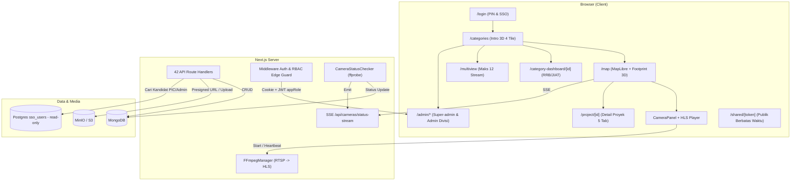

# TENGOK — Surveillance & Project Control System

Sistem monitoring CCTV real-time dan kendali proyek terintegrasi berbasis web untuk **PT Brantas Abipraya**. Menggabungkan pemantauan stream kamera RTSP/HLS di peta interaktif, sekuens navigasi 3D per divisi, detail proyek (kontrak, progres fisik/keuangan, laporan bulanan, Kurva S, QHSSE, change management, galeri & dokumen), dashboard program lintas proyek, serta panel administrasi berbasis role (**RBAC**).

---

## 1. Tech Stack

| Kategori | Teknologi | Versi | Fungsi |
|---|---|---|---|
| **Framework** | Next.js (App Router) | 16.4.6 | Full-stack React framework (SSR + API Routes, `--webpack`) |
| **Runtime** | React & TypeScript | 19.2.3 / 5 | UI rendering & type safety |
| **Database** | MongoDB + Mongoose | 8.23.0 | Penyimpanan proyek, kamera, kategori, audit, dan role |
| **Auth & SSO** | NextAuth v5 (Cognito) + PIN | 5.0.0-beta.30 | Dual auth: PIN viewer & Cognito SSO untuk admin/PIC |
| **Peta & 3D** | MapLibre GL + Three.js | 5.24.0 / 0.160.1 | Peta proyek 3D footprint, intro 3D HQ/divisi (Leaflet untuk picker admin) |
| **Video** | FFmpeg + hls.js | 1.6.15 | Transmux RTSP→HLS (`-c:v copy`) & playback browser |
| **Storage** | MinIO / S3 (`@aws-sdk/client-s3`) | 3.1143.0 | Penyimpanan dokumen & galeri proyek (presigned URL) |
| **Styling & UI** | Tailwind CSS v4 + Framer Motion | v4 / 12.35.2 | Utility CSS, tema divisi dinamis, animasi |
| **Visualisasi & PDF** | Recharts + jsPDF | 3.8.1 / 4.2.1 | Grafik EVM/Kurva S/QHSSE & ekspor laporan PDF |
| **Data & Form** | SWR + Axios + React Hook Form + Zod | 2.4 / 1.13 / 7.71 / 4.3 | Data fetching, validasi, caching |

---

## 2. Arsitektur & Alur Utama



---

## 3. Autentikasi & RBAC

Tengok memiliki dua jalur masuk dan kontrol akses bertingkat:

| Peran | Jalur Masuk | Hak Akses |
|---|---|---|
| **Viewer (PIN)** | Cookie `auth_token` (TTL 7 hari, `PinSession`) | Melihat `/categories`, `/map`, live CCTV, `/multiview`, dan `/category-dashboard/*`. Tidak bisa membuka `/project/[id]` maupun `/admin/*`. |
| **User SSO / PIC** | Cognito SSO (JWT 8 jam bergulir) | Dapat membuka `/project/[id]`; hanya dapat mengedit/mengunggah proyek yang menempatkan `cognitoSub`-nya di `Location.picSubs`. Tidak masuk `/admin/*`. |
| **Admin Divisi (`divisi_admin`)** | Cognito SSO + `AppRole` | Akses `/admin`, `/admin/cameras`, `/admin/locations`, `/admin/pengisian`, serta edit `/project/[id]` **khusus proyek & kamera di divisinya (`DIVISI 1`, `DIVISI 2`, atau `DIVISI 3`)**. Tidak punya akses ke Statistik, Uptime, Notifikasi, Share Links, Kategori, Hak Akses, maupun Audit Log. |
| **Super-admin (`superadmin`)** | Cognito SSO + `AppRole` / `TENGOK_BOOTSTRAP_ADMIN_SUBS` | Akses penuh seluruh modul `/admin/*` (termasuk Hak Akses `/admin/roles`, Kategori, Share Links, Statistik, Audit Log), edit semua proyek, serta menunjuk PIC & Admin Divisi. |

---

## 4. Halaman Aplikasi

| Route | Akses | Deskripsi |
|---|---|---|
| `/login` | Publik | Login dual-tab (PIN cepat & Cognito SSO) |
| `/categories` | Auth (PIN/SSO) | Landing utama dengan intro 3D HQ & 4 tile (Divisi 1–3 + Hub RRB) |
| `/map` | Auth (PIN/SSO) | Peta interaktif MapLibre dengan marker status CCTV & blok footprint 3D |
| `/multiview` | Auth (PIN/SSO) | Pantau hingga 12 kamera serentak |
| `/category-dashboard/[id]` | Auth (PIN/SSO) | Dashboard program model RRB (`rrb`, `irigasi-jiat`) |
| `/project/[id]` | SSO-only | Detail proyek 5 tab + Laporan Bulanan, Kurva S, QHSSE, galeri & dokumen |
| `/shared/[token]` | Publik (Token) | Tautan berbagi sementara lokasi CCTV tanpa login |
| `/admin` | `superadmin` / `divisi_admin` | Executive Dashboard (super-admin) atau Dashboard Operasional (divisi) |
| `/admin/cameras` | `superadmin` / `divisi_admin` | Manajemen kamera (tampilan tabel/kartu, filter divisi/lokasi, test stream, tautan lokasi langsung, import/export CSV) |
| `/admin/locations` | `superadmin` / `divisi_admin` | Manajemen lokasi/proyek & koordinat peta |
| `/admin/pengisian` | `superadmin` / `divisi_admin` | Rekap pengisian 18 dimensi per divisi + ekspor PDF |
| `/admin/categories` | `superadmin` | Manajemen kategori (modal 2-kolom dengan sticky preview, sync peta default, proteksi identifier & hapus aman) |
| `/admin/share-links` | `superadmin` | Buat & kelola tautan berbagi publik |
| `/admin/statistics` | `superadmin` | Analitik kunjungan & perangkat |
| `/admin/uptime` | `superadmin` | Riwayat ketersediaan & SLA kamera |
| `/admin/notifications` | `superadmin` | Pengaturan notice/pengumuman global peta |
| `/admin/roles` | `superadmin` | Kelola Super-admin dan Admin Divisi |
| `/admin/audit-log` | `superadmin` | Log jejak perubahan sistem (TTL 90 hari) |

---

## 5. Struktur Direktori Utama

```
src/
├── app/
│   ├── api/                 # 42 route handlers (auth, admin, cameras, categories, locations, projects, streams, dll.)
│   ├── admin/               # Halaman konsol admin (layout gating + RBAC)
│   ├── categories/          # Intro 3D & navigasi divisi
│   ├── category-dashboard/  # Dashboard program RRB/JIAT
│   ├── login/               # Halaman login PIN & SSO
│   ├── map/                 # Peta MapLibre + panel kamera
│   ├── multiview/           # Grid multi-stream
│   ├── project/[id]/        # Detail proyek 5 tab + Laporan Bulanan
│   └── shared/[token]/      # Halaman share link publik
├── components/
│   ├── admin/               # AdminUI, CoordinateInput, shared, dan cameras/* (modals)
│   ├── intro/               # IntroScene3D, hqModel, divisionModels
│   └── project/             # ProjectDashboard, LaporanBulananTab, QHSSE components
├── hooks/                   # useCameraStatusSSE, usePageTracking
├── lib/                     # auth, apiAuth, db, ffmpegManager, cameraStatusChecker, projectReport, pengisian, storage, dll.
├── models/                  # Mongoose models (Location, Camera, Category, AppRole, ShareLink, AuditLog, PinSession, SsoIdentity, dll.)
└── middleware.ts            # Auth & RBAC edge guard + allowlist publik
```

---

## 6. Menjalankan Secara Lokal

### Prasyarat
- **Node.js 24 LTS** (`.nvmrc`)
- **FFmpeg & ffprobe** tersedia di `PATH`
- **MongoDB** (lokal atau Atlas)
- Opsional: **MinIO/S3** (upload dokumen/galeri), **Postgres** (direktori user SSO `sso_users`), **AWS Cognito** (SSO login)

### Perintah

```bash
# 1. Install dependencies
npm install

# 2. Salin & lengkapi variabel lingkungan (.env.local)
cp .env.example .env.local

# 3. Jalankan mode development (memakai webpack)
npm run dev

# 4. Build & jalankan produksi (standalone)
npm run build
npm start
```

---

## 7. Variabel Lingkungan Penting

Lihat `.env.example` untuk daftar lengkap:
- `MONGODB_URI` — URL koneksi MongoDB
- `APP_PIN` — PIN akses viewer (kosong = semua login PIN ditolak)
- `COGNITO_CLIENT_ID`, `COGNITO_CLIENT_SECRET`, `COGNITO_ISSUER`, `COGNITO_DOMAIN` — Konfigurasi AWS Cognito SSO
- `NEXTAUTH_SECRET`, `NEXTAUTH_URL` — Konfigurasi NextAuth v5
- `TENGOK_BOOTSTRAP_ADMIN_SUBS` — Daftar `cognito_sub` super-admin permanen (dipisah koma)
- `NEXT_PUBLIC_MAPTILER_KEY` — API key peta MapTiler (opsional; fallback OpenFreeMap)
- `MINIO_ENDPOINT`, `MINIO_PORT`, `MINIO_USE_SSL`, `MINIO_REGION`, `MINIO_ACCESS_KEY`, `MINIO_SECRET_KEY`, `MINIO_BUCKET` — Storage objek proyek
- `SSO_PG_HOST`, `SSO_PG_DATABASE`, `SSO_PG_USER`, `SSO_PG_PASSWORD`, `SSO_PG_PORT`, `SSO_PG_SSL` — Direktori user SSO read-only untuk pencarian kandidat PIC & admin
